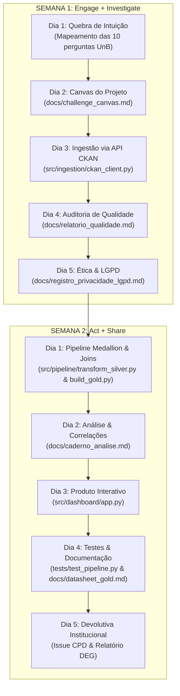

# 🎓 Relatório Geral de Projeto: Retenção, Formatura e Evasão na UnB
### Conexão Completa com o Challenge de Dados Abertos (Semanas 1 a 14 - CBL)

> **Documento Síntese da Disciplina de Banco de Dados 2 (UnB)**  
> **Tema**: Discrepância entre o tempo regulamentar e o tempo real de conclusão nos cursos de graduação da UnB, retenção crítica e taxas de evasão.  
> **Stakeholder Principal**: Decanato de Ensino de Graduação (DEG/DAA) e Coordenações de Cursos de Graduação.  
> **Portal Auditado**: [dados.unb.br](https://dados.unb.br) (API aberta CKAN 2.11).

> [!NOTE]
> As seções 1 a 6 registram a primeira versão do projeto, das semanas 1 e 2 (só SIGRA, camadas em
> CSV), e os números delas são daquela época. As seções 7 a 12 seguem o projeto de 2 em 2 semanas,
> até a semana 14: PostgreSQL, SIGAA, 3NF e Star Schema, lago Delta com CDC (E2) e a camada analítica
> em dbt orquestrada pelo Dagster (E3). Os valores atuais estão em [`docs/caderno_analise.md`](docs/caderno_analise.md)
> e no [README](README.md#-3-principais-resultados-e-achados); o processo semana a semana, com as
> medições, está no [diário de bordo](docs/diario/diario_de_bordo.md).

---

## 1. Conexão com o Plano de 2 Semanas (Metodologia CBL)

O projeto foi construído respeitando rigorosamente a metodologia **Challenge Based Learning (CBL)** nas 4 fases (*Engage*, *Investigate*, *Act*, *Share*), mapeando cada exigência diária em artefatos versionados e executáveis:



### Mapeamento dos Entregáveis por Dia

| Fase / Dia | Exigência do Plano | Entregável Concretizado no Repositório |
| :--- | :--- | :--- |
| **S1 · Dia 2** | Stakeholder, Essential Question, Challenge e 5 Guiding Questions. | [`docs/challenge_canvas.md`](docs/challenge_canvas.md) |
| **S1 · Dia 3** | Ingestão programática via API sem download manual. | [`src/ingestion/ckan_client.py`](src/ingestion/ckan_client.py) $\rightarrow$ `data/bronze/` |
| **S1 · Dia 4** | Relatório de qualidade (8 achados com evidência) + Issue para o portal. | [`docs/relatorio_qualidade.md`](docs/relatorio_qualidade.md) |
| **S1 · Dia 5** | Análise de quase-identificadores, $k$-anonimato e slide obrigatório. | [`docs/registro_privacidade_lgpd.md`](docs/registro_privacidade_lgpd.md) |
| **S2 · Dia 1** | Pipeline Bronze $\rightarrow$ Silver $\rightarrow$ Gold com join heterogêneo auditado. | [`src/pipeline/transform_silver.py`](src/pipeline/transform_silver.py) e [`build_gold.py`](src/pipeline/build_gold.py) |
| **S2 · Dia 2** | Caderno de análise com respostas às 5 GQs e "A Correlação Suspeita". | [`docs/caderno_analise.md`](docs/caderno_analise.md) |
| **S2 · Dia 3** | Produto navegável autônomo para o stakeholder. | [`src/dashboard/app.py`](src/dashboard/app.py) (Streamlit Interativo) |
| **S2 · Dia 4** | Documentação formal (Datasheet for Datasets e Dicionário Gold) + Testes. | [`docs/datasheet_gold.md`](docs/datasheet_gold.md), [`docs/dicionario_dados_gold.md`](docs/dicionario_dados_gold.md), [`tests/test_pipeline.py`](tests/test_pipeline.py) |
| **S2 · Dia 5** | Devolutiva cívica à instituição e encerramento. | Rascunho da Issue para o CPD integrado na aba de Governança do Painel. |

---

## 2. A Lógica da Escolha das Bases de Dados

Para responder com precisão científica à pergunta *"Quanto tempo os alunos realmente levam para se formar e quais são os cursos mais difíceis?"*, **nenhuma base isolada da UnB é suficiente**:

1. **Se olhássemos apenas o SIGRA / Concluintes**:
   - Saberíamos quando o aluno entrou e quando saiu, mas **não saberíamos qual era o tempo regulamentar** daquele curso (se era de 8, 9, 10 ou 12 semestres). Não daria para saber se 10 semestres representam atraso (em Pedagogia) ou pontualidade perfeita (em Medicina ou Engenharia).
2. **Se olhássemos apenas a Estrutura Curricular**:
   - Saberíamos os prazos teóricos, mínimos, ideais e máximos (jubilamento), mas **não teríamos a realidade empírica** dos alunos (quantos formaram, quantos evadiram e quantos semestres reais foram cursados).
3. **Se olhássemos apenas o Catálogo de Cursos de Graduação**:
   - Teríamos o nome do curso, campus e turno, mas sem matriz curricular nem dados históricos de movimentação.

Por isso, construímos o cruzamento de **três bases complementares**:

```
                              ┌─────────────────────────────────────────────────────────┐
                              │                    PORTAL DADOS.UNB.BR                  │
                              └───────────────────────────┬─────────────────────────────┘
                                                          │
                   ┌──────────────────────────────────────┼──────────────────────────────────────┐
                   ▼                                      ▼                                      ▼
    ┌─────────────────────────────┐        ┌─────────────────────────────┐        ┌─────────────────────────────┐
    │          SIGRA.CSV          │        │  ESTRUTURA-CURRICULAR.CSV   │        │     CURSO_GRADUACAO.CSV     │
    │          (24.56 MB)         │        │          (76.4 KB)          │        │          (45.4 KB)          │
    ├─────────────────────────────┤        ├─────────────────────────────┤        ├─────────────────────────────┤
    │ • 60.695 discentes graduação│        │ • 113 estruturas curriculares│       │ • 157 cursos catalogados    │
    │ • ano_ingresso (ex: 2010)   │        │ • semestre_conclusao_minimo │        │ • turno (Diurno / Noturno)  │
    │ • periodo_saida (ex: 20141) │        │ • semestre_conclusao_ideal  │        │ • campus (Darcy, FGA, etc.) │
    │ • forma_saida (Formatura,   │        │ • semestre_conclusao_maximo │        │ • area_conhecimento         │
    │   Abandono, Jubilamento)    │        │ • ch_total_minima           │        │ • unidade_responsavel       │
    └──────────────┬──────────────┘        └──────────────┬──────────────┘        └──────────────┬──────────────┘
                   │                                      │                                      │
                   └──────────────────────────────────────┼──────────────────────────────────────┘
                                                          ▼
                                           ┌─────────────────────────────┐
                                           │       CAMADA SILVER         │
                                           │  • Limpeza & NFKD Uppercase │
                                           │  • Encoding Latin-1 -> UTF8 │
                                           │  • Strip de padding de texto│
                                           │  • Cálculo de permanência   │
                                           └──────────────┬──────────────┘
                                                          │
                                                          ▼
                                           ┌─────────────────────────────┐
                                           │        CAMADA GOLD          │
                                           │  (retencao_cursos_unb.csv)  │
                                           │ • Taxa Casamento: 97.54%    │
                                           │ • Métricas de Retenção (IRC)│
                                           │ • % Formatura no Prazo      │
                                           │ • % Evasão / Jubilamento    │
                                           └──────────────┬──────────────┘
                                                          │
                                                          ▼
                                           ┌─────────────────────────────┐
                                           │      PRODUTO STREAMLIT      │
                                           │   (Suporte à Decisão DEG)   │
                                           └─────────────────────────────┘
```

---

## 3. Como as Bases se Conectam e Como as Armadilhas Foram Superadas

A integração dessas fontes exigiu superar uma série de **armadilhas reais de dados** documentadas no Dia 4 da Semana 1:

### A. Desafios de Engenharia de Dados Superados
1. **Inconsistência de Encoding**: A base `estrutura-curricular.csv` veio codificada em `ISO-8859-1 (Latin-1)` com acentos corrompidos ao ser aberta como UTF-8. O pipeline foi parametrizado com leitura em Latin-1 e conversão canônica.
2. **Inconsistência de Delimitadores**: O SIGRA e a Estrutura usam `;`, enquanto Cursos usa `,`. Cada leitor foi isolado com declaração explícita de dialecto RFC 4180.
3. **Padding Excessivo**: O SIGRA apresentava até 30 espaços em branco à direita dos nomes (ex: `'DIREITO                            '`). Aplicamos strip e regex de espaços contínuos.
4. **Mapeamento de Sinônimos e Habilitações**:
   - O SIGRA traz nomes como `CONTROLE E AUTOMACAO` e `LINGUA PORTUGUESA E RESPECTIVA LITERATURA`, enquanto a estrutura registra `ENGENHARIA MECATRONICA - CONTROLE E AUTOMACAO` e `LETRAS`.
   - Implementamos um **dicionário de mapeamento canônico (alias mapping)** de 32 pares de sinônimos.
   - **Resultado**: Elevamos a taxa de casamento dos discentes de **86.09%** para **97.54%** (59.202 discentes casados perfeitamente).

---

## 4. O Refinamento Metodológico: Tratando o "Viés de Sobrevivência"

A proposta inicial do grupo era avaliar a dificuldade puramente pela porcentagem de alunos que formam no tempo mínimo, ideal ou máximo. Durante a análise, identificamos um risco analítico severo:

> **O Viés de Sobrevivência (Survival Bias)**:  
> Se avaliássemos apenas os alunos formados (`forma_saida == 'Formatura'`), cursos com evasão massiva (onde 75% dos alunos desistem e os 25% mais fortes que sobram formam no prazo) pareceriam falsamente "mais fáceis" ou mais pontuais que cursos com 90% de formatura onde os alunos demoram 1 semestre a mais.

### A Solução: O Índice de Retenção Crítica (IRC)
Criamos um indicador composto normalizado (0 a 100) que equilibra:
$$\text{IRC} = 50\% \times \text{Normalizado}(\text{Atraso Médio na Formatura}) + 50\% \times \text{Normalizado}(\text{Taxa de Evasão})$$

> Esta é a versão das semanas 1 e 2. Em 09/2026 os pesos passaram a 0,3 para o atraso e 0,7 para a evasão, com cada termo saturado nos percentis 5 e 95 antes da normalização ([ADR 0006](docs/adr/0006-indice-retencao-critica.md)): perder o aluno pesa mais que ele se formar devagar.

Esse índice classifica a criticidade dos cursos em 4 faixas:
* **Retenção Crítica (Top 25% mais retentores)**: Cursos que combinam **alto atraso** e **alta evasão** (ex: *Engenharia Geral*, *Física Computacional*, *Ciência da Computação*, *Computação Licenciatura*).
* **Retenção Alta / Média / Baixa**: Cursos com alto índice de conclusão no prazo e baixa evasão (ex: *Direito*, *Gestão do Agronegócio*, *Engenharia de Redes*, *Medicina Veterinária*).

---

## 5. Como Tudo Isso Vai Servir para o Stakeholder na Prática

O produto final não é apenas um relatório estático; é um **painel interativo de suporte à decisão** voltado para o **Decanato de Ensino de Graduação (DEG)**, a **Diretoria de Acompanhamento e Integração Acadêmica (DAIA)** e os **Colegiados de Curso**.

### 4 Casos de Uso Reais de Tomada de Decisão:

```
┌──────────────────────────────────────────────────────────────────────────────────────────────────┐
│                             DECISÕES PRÁTICAS DO STAKEHOLDER (DEG/DAA)                           │
├────────────────────────────────┬────────────────────────────────┬────────────────────────────────┤
│      1. REVISÃO DE FLUXOS      │     2. TURMAS E MONITORIA      │     3. DIAGNÓSTICO NOTURNO     │
│  Identificar cursos em que a   │  Direcionar bolsas de monitoria│  Compreender que o noturno não │
│  cadeia de pré-requisitos trava│  e abertura de turmas extras   │  precisa de mais prazo, mas de │
│  o aluno por mais de 3 sem.    │  para as matérias-gargalo de   │  apoio contra a evasão (taxa   │
│  (ex: Computação e Engenharias)│  cursos com IRC Crítico.       │  de evasão de 52.5% vs 29.4%). │
└────────────────────────────────┴────────────────────────────────┴────────────────────────────────┘
```

1. **Revisão Prioritária de Matrizes Curriculares Críticas**:
   - *Evidência*: Ciência da Computação possui tempo médio real de 12.37 semestres para uma matriz de 9 semestres (atraso médio de **+3.37 semestres**) e evasão de **59.14%**.
   - *Decisão*: O DEG pode notificar a coordenação do curso para rever disciplinas que atuam como "gargalos" bloqueantes de pré-requisitos.
2. **Políticas de Permanência Específicas para Cursos Noturnos**:
   - *Evidência*: Os cursos noturnos não apresentam atraso excessivo em relação à sua própria matriz regulamentar, mas sofrem com taxa média de evasão de **52.54%** (contra **29.43%** nos diurnos).
   - *Decisão*: A assistência estudantil e a flexibilização de horários devem ser focadas em evitar o abandono do aluno trabalhador.
3. **Planejamento de Vagas e Alocação de Docentes**:
   - *Evidência*: Relação clara de quais cursos retêm discentes por mais de 14 semestres, consumindo vagas em turmas de ciclos básicos repetidamente.
   - *Decisão*: Alocar mais turmas e monitores nas disciplinas básicas de exatas para desafogar a retenção no início do fluxo.
4. **Transparência e Orientação ao Calouro**:
   - *Evidência*: O estudante consegue consultar previamente a distribuição empírica de conclusão do seu curso (ex: saber que em Direito 92.4% formam no prazo, enquanto em Física Computacional apenas 25% formam no tempo ideal).

---

## 6. Conformidade Ética, LGPD e Governança

1. **Avaliação de Quase-Identificadores**: Demonstramos analiticamente no Dia 5 que cruzar `(curso, data_nascimento, sexo, raca_cor)` na base bruta do SIGRA produz **88.93% de registros com $k = 1$** (identificação unívoca).
2. **Salvaguarda Implementada**: A camada Gold e o Dashboard expõem **exclusivamente dados agregados por curso** ($k \ge 5$), eliminando qualquer possibilidade de reidentificação de discentes individuais.
3. **Devolutiva Cívica**: Redigimos a minuta formal de uma Issue para a equipe de TI da UnB (CPD), reportando as inconsistências de encoding e padding para aprimoramento contínuo do portal de Dados Abertos.

---

## 7. Semanas 3 e 4 — Iniciação Científica, CI/CD, Benchmark INEP e PostgreSQL

**O que foi feito**
- **PIBIC no painel:** os projetos de iniciação científica mapeados por curso e ano (12.793 na carga de 03/11/2026), com o valor das bolsas estimado pela tabela de vigências do CNPq ([ADR 0023](docs/adr/0023-valor-bolsa-ic-pela-tabela-do-cnpq.md)). A base pública não traz a matrícula do bolsista, então a junção é por curso, sem cruzar com discentes.
- **Simulador What-If:** o DEG simula a evasão evitada e vê o retorno econômico pelo custo médio do discente.
- **CI/CD:** o workflow `medalhao.yml` roda o medalhão do zero e publica o painel no GitHub Pages com `stlite`, sem servidor ([ADR 0007](docs/adr/0007-painel-streamlit-stlite-pages.md)).
- **Benchmark nacional:** o Censo da Educação Superior do INEP compara a evasão e a conclusão da UnB com as outras federais ([ADR 0008](docs/adr/0008-benchmark-inep-censo-2019.md)). Como o servidor do INEP cai com frequência, o CI segue com o benchmark anterior quando ele falha.
- **PostgreSQL:** o esquema passa a ser versionado em migrações SQL com checksum, e `gravar()` recusa coluna que a tabela não tem ([ADR 0009](docs/adr/0009-postgres-migracoes-contrato.md)). O pipeline inteiro sobe com `docker compose up --build`.

**Para o DEG:** o painel passa a mostrar o perfil social da iniciação científica e a posição de cada curso contra a média nacional.

---

## 8. Semanas 5 e 6 — SIGAA, Busca Semântica, 3NF e Star Schema

**O que foi feito**
- **União do SIGAA com o SIGRA:** a base passou de 60.695 discentes (só SIGRA) para **152.680 vínculos**, 100% casados com a estrutura curricular ([ADR 0012](docs/adr/0012-sigaa-uniao-com-sigra.md)). Isso exigiu regras novas:
  - evasão é toda saída sem diploma registrado ([ADR 0013](docs/adr/0013-evasao-saida-sem-diploma.md));
  - só entram coortes com 8 anos de acompanhamento, de 2010 a 2016 ([ADR 0014](docs/adr/0014-janela-maturacao-8-anos.md));
  - no SIGAA, o semestre de saída é estimado pela data de registro do diploma ([ADR 0015](docs/adr/0015-semestre-de-saida-estimado.md));
  - arquivos com nome de discente ficam fora da ingestão ([ADR 0017](docs/adr/0017-arquivos-nominais-fora.md)).
- **Alunos ativos hoje:** quem ainda está matriculado e já passou do prazo ideal ou do máximo ([ADR 0019](docs/adr/0019-ativos-hoje.md), [ADR 0020](docs/adr/0020-lista-de-ativos-com-minimizacao.md)).
- **Busca semântica com pgvector:** cursos, planos de IC e documentação vetorizados com um modelo multilíngue local ([ADR 0011](docs/adr/0011-busca-semantica-pgvector.md)).
- **Silver em 3NF e Gold em Star Schema**, com a prova da normalização em [`docs/arquitetura/`](docs/arquitetura/) e os vínculos particionados por ano de ingresso.
- **Fim dos CSVs:** todas as camadas passam a ser gravadas direto no banco, e os CSVs saem do repositório.
- **Atualização mensal automática:** o GitHub Actions baixa as fontes no dia 1 de cada mês e, nesta fase, versionava a gold na `main` ([ADR 0018](docs/adr/0018-atualizacao-mensal-commit-na-main.md)). Desde que a gold passou a viver só no banco, o bot versiona apenas a série do valor da bolsa e os relatórios gerados, e o painel é republicado a partir de um novo export. O catálogo de cursos guarda todas as versões publicadas ([ADR 0021](docs/adr/0021-catalogo-todas-as-versoes.md)), e os cursos-tronco saem dos rankings por curso ([ADR 0022](docs/adr/0022-cursos-tronco.md)).

**Para o DEG:** os números passam a cobrir os dois sistemas acadêmicos, e o painel ganha a página de alunos ativos acima do prazo.

---

## 9. Semanas 7 e 8 — Pipeline Direto no Banco e Lago em Formato Aberto

**O que foi feito**
- **Carga da Silver 3NF e do Star Schema em SQL:** 152.680 vínculos, 158 cursos e 112 matrizes, em cerca de 46 s, sem arquivo intermediário. As restrições `CHECK` recusaram dado real na primeira carga (semestre de verão, mínimos zerados, turnos fora do domínio) e foram ajustadas ao domínio da fonte.
- **Linhas descartadas registradas:** `bronze.ingestoes.linhas_descartadas` guarda quantas linhas malformadas cada leitura pulou.
- **Sincronização com o Supabase:** a gold e o Star Schema vão para o banco remoto pela chave natural, sem apagar nada.
- **View do painel** atualizada com `REFRESH CONCURRENTLY`, numa etapa própria do pipeline.
- **Censo do INEP lido em blocos de 50 mil linhas**, com staging e troca numa transação única.
- **Partições futuras** dos vínculos criadas automaticamente por quinquênio.
- **Lago Delta Lake sobre Parquet com ZSTD nível 3**, particionado por quinquênio de ingresso ([ADR 0024](docs/adr/0024-lago-delta-parquet-zstd.md)). O ZSTD empatou com o GZIP no tamanho (~1,4 MB) e escreveu 20 vezes mais rápido (173 ms contra 3.527 ms).

**Para o DEG:** os dados ficam num formato aberto, que DuckDB, Spark ou pandas leem sem o banco.

---

## 10. Semanas 9 e 10 — Captura de Mudanças e Dado Atrasado (Entrega E2)

**O que foi feito**
- **CDC com Debezium e Kafka:** mudanças na Silver 3NF saem do WAL do PostgreSQL e chegam ao lago Delta em 0,25 s a 0,87 s.
- **Semântica de entrega:** pelo menos uma vez no transporte, com o offset confirmado só depois da gravação, e exatamente uma vez no efeito, com `MERGE` idempotente pela posição no WAL. Os reprocessamentos forçados não mudaram nenhuma linha do lago.
- **Exclusão lógica:** um DELETE vira marca (`_deletado`), para que um INSERT reprocessado não ressuscite a linha. O `TRUNCATE` da recarga também é tratado.
- **Recarga em lote como mecanismo principal e CDC como opcional**, com latência e custo medidos ([ADR 0025](docs/adr/0025-mecanismo-de-ingestao-recarga-e-cdc.md)).
- **Dado atrasado:** o registro de diploma chega até 105 dias depois do fim do semestre (p99). A marca d'água com 4 meses de tolerância cobre 99,2% das conclusões. Cada carga é classificada em `NO_PRAZO`, `ATRASADA` ou `SEM_PERIODO`, nada é descartado, e o lago regrava só as janelas que mudaram ([ADR 0026](docs/adr/0026-dado-atrasado-marca-dagua.md)).
- **Supabase:** um workflow diário evita que o banco remoto pause por inatividade.

**Entrega E2:** tabela de aceite no [README](README.md) e [diário de bordo](docs/diario/diario_de_bordo.md) das semanas 1 a 10.

---

## 11. Semanas 11 e 12 — Fechamento da E2

**O que foi feito**
- **Prova do exatamente uma vez:** `src/cdc/demonstrar_reprocessamento.py` derruba o consumidor antes de confirmar o offset, relê os tópicos desde o início e exclui os sentinelas. A impressão digital do lago não muda em nenhum dos reprocessamentos.
- **Revisão da E2:**
  - tabela de aceite da E2 no README;
  - testes unitários (`test_unit_*`) rodando no CI, sem banco nem Kafka;
  - checagem do tamanho máximo dos arquivos versionados;
  - portas do Compose só no `127.0.0.1`.
- **Diário de bordo** das semanas 1 a 10 publicado, com os números sem fonte corrigidos.
- **DER sincronizado:** um teste confere que o diagrama da gold bate com o catálogo do banco.
- **Ajuste do keep-alive do Supabase.**

---

## 12. Semanas 13 e 14 — Camada Analítica em dbt, Testada e Orquestrada (Entrega E3)

**O que foi feito**
- **Consulta otimizada pelo plano de execução:** o detalhamento de um curso na Silver 3NF caiu de 1.566 para 14 buffers e de 35,6 ms para 0,42 ms com um índice de cobertura. Os planos `EXPLAIN (ANALYZE, BUFFERS)` de antes e de depois estão em [`docs/explain/`](docs/explain/).
- **Grão do fato declarado e medido:** o fato de retenção tem "um registro por curso canônico", imposto por chave única. Quatro grãos foram medidos:
  - o grão do curso (101 linhas) responde à E1 sem perder vínculo;
  - o grão por semestre de saída perderia 28% dos vínculos para o k-anonimato.
- **Dimensão de variação lenta:** a `dim_curso` virou SCD tipo 2. Uma reclassificação abre uma versão nova sem apagar a anterior, na gold ([ADR 0028](docs/adr/0028-dim-curso-scd-tipo-2.md)) e, desde a semana 14, também no dbt, por snapshot.
- **Transformações em dbt** ([ADR 0029](docs/adr/0029-transformacoes-em-dbt.md)):
  - três camadas: staging, intermediate e marts;
  - 65 testes de dados: esquema, volume, unicidade, integridade referencial, distribuição e domínio;
  - `tests/test_dbt_dado_ruim.py` prova que cada tipo de teste falha com dado injetado;
  - o fato do dbt é reconciliado, curso a curso, com a gold.
- **Agregações da gold em SQL nativo**, no banco ([ADR 0027](docs/adr/0027-agregacoes-gold-em-sql-nativo.md)).
- **Orquestração em Dagster** ([ADR 0030](docs/adr/0030-modelagem-analitica-e-ferramentas.md)): o pipeline virou um grafo de assets com retry por etapa e backfill por quinquênio. A execução mensal é disparada pelo GitHub Actions. As demonstrações estão em [`docs/orquestracao/evidencias/`](docs/orquestracao/evidencias/):
  - com o banco derrubado de propósito, a etapa foi repetida e passou quando ele voltou;
  - com a falha definitiva, as etapas dependentes não rodaram;
  - o backfill recuperou uma janela apagada do lago sem duplicar.
- **Frescor e SLA:** a view do painel tem SLA de 35 dias, conferido todo dia ([`docs/frescor_sla.md`](docs/frescor_sla.md)).
- **Resposta à pergunta da E1 no painel:** a Visão Executiva abre com a pergunta e com o ranking de cursos críticos lido do mart do dbt. Na carga de 03/11/2026, **23 cursos** estão em retenção crítica, e os primeiros da fila são Física Computacional, Computação e Ciência da Computação.
- **Busca híbrida:** combina o embedding com a busca em texto completo e indexa toda a documentação. Ela é medida com 20 consultas de referência e recall@5 de ao menos 0,8.

**Entrega E3:** tabela de aceite no [README](README.md).

---

## 13. Como Executar os Artefatos do Projeto

O passo a passo completo está no [README](README.md#-2-como-reproduzir-o-projeto-do-zero). O caminho curto:

```bash
# 1. Banco, pipeline inteiro e painel, com um comando (http://localhost:8501)
docker compose up --build

# 2. Suíte de testes: test_unit_* sem banco; os demais com o banco no ar
python3 -m unittest discover -s tests -p "test_*.py"

# 3. Só o painel, lendo o banco (ou export/gold.json, sem banco)
streamlit run src/dashboard/app.py
```

O painel publicado fica em **https://observatorio-unb.github.io/observatorio-unb/**, com estas páginas:
- **Visão Executiva (DEG)**: abre com a pergunta da E1 e a resposta, o ranking de cursos críticos pelo IRC lido de `dbt_marts.painel_cursos_criticos`, seguidos dos KPIs e da matriz de dispersão;
- **Detalhe por Curso**, com busca e gráficos de distribuição;
- **Alunos Ativos** (quem está hoje acima do prazo ideal e do máximo);
- **Noturno vs. Diurno & Turnos**;
- **PIBIC & Inclusão Social na Ciência**;
- **Benchmark Nacional (INEP)**;
- **Simulador What-If & Custo da Retenção**;
- **Auditoria & Qualidade de Dados**, com os 12 achados do portal;
- **O Que Este Dado NÃO Responde**, com os limites metodológicos.

No painel local, com o banco no ar, aparece também a página de **busca semântica**. Ela não existe no GitHub Pages, que roda sem banco.
