# Catálogo e linhagem: da fonte pública ao consumo

> Gerado por `python3 src/governanca/linhagem.py` a partir do código (configuração da ingestão, etapas declaradas e verificadas contra os scripts) e do manifest do dbt. Não edite à mão: o CI falha se este arquivo estiver desatualizado (`--verificar`).

O grafo do dbt (Silver 3NF → marts → consumidores) também está no dbt docs publicado no GitHub Pages, em `/dbt/`. Este documento junta a ele o trecho que o dbt não enxerga: portal → bronze → silver → Silver 3NF e gold.

## 1. Grafo

```mermaid
flowchart LR
  subgraph Fonte_p_blica["Fonte pública"]
    portal_cnpq_bolsas(["cnpq_bolsas"])
    portal_cursos_graduacao(["cursos_graduacao"])
    portal_estrutura_curricular(["estrutura_curricular"])
    portal_inep_censo_2019(["inep_censo_2019"])
    portal_pibic(["pibic"])
    portal_sigaa(["sigaa"])
    portal_sigaa_ativos(["sigaa_ativos"])
    portal_sigra(["sigra"])
  end
  subgraph Bronze["Bronze"]
    bronze_bolsistas_iniciacao_cientifica["bronze.bolsistas_iniciacao_cientifica"]
    bronze_cursos_graduacao["bronze.cursos_graduacao"]
    bronze_estrutura_curricular["bronze.estrutura_curricular"]
    bronze_inep_censo_superior_federais["bronze.inep_censo_superior_federais"]
    bronze_sigaa_ativos["bronze.sigaa_ativos"]
    bronze_sigaa_discentes["bronze.sigaa_discentes"]
    bronze_sigra_discentes["bronze.sigra_discentes"]
    data_bronze_cnpq_valor_bolsa_ic_json["cnpq_valor_bolsa_ic.json"]
  end
  subgraph Silver["Silver"]
    silver_cursos_graduacao["silver.cursos_graduacao"]
    silver_discentes_graduacao["silver.discentes_graduacao"]
    silver_estrutura_curricular["silver.estrutura_curricular"]
    silver_inep_censo_superior["silver.inep_censo_superior"]
    silver_pibic_bolsistas["silver.pibic_bolsistas"]
    silver_sigaa_ativos["silver.sigaa_ativos"]
  end
  subgraph Silver_3NF__OLTP_["Silver 3NF (OLTP)"]
    silver_cursos["silver.cursos"]
    silver_discentes["silver.discentes"]
    silver_estruturas_curriculares["silver.estruturas_curriculares"]
    silver_movimentacoes_vinculos["silver.movimentacoes_vinculos"]
  end
  subgraph Gold["Gold"]
    gold_ativos_hoje_cursos_unb["gold.ativos_hoje_cursos_unb"]
    gold_dim_campus["gold.dim_campus"]
    gold_dim_curso["gold.dim_curso"]
    gold_fato_retencao_curso["gold.fato_retencao_curso"]
    gold_inep_benchmark_cursos_unb["gold.inep_benchmark_cursos_unb"]
    gold_pibic_social_unb["gold.pibic_social_unb"]
    gold_regras_harmonizacao_canonicas["gold.regras_harmonizacao_canonicas"]
    gold_retencao_cursos_coorte["gold.retencao_cursos_coorte"]
    gold_retencao_cursos_unb["gold.retencao_cursos_unb"]
  end
  subgraph dbt["dbt"]
    dbt_intermediate_int_atributos_curso["dbt_intermediate.int_atributos_curso"]
    dbt_intermediate_int_bases_curso["dbt_intermediate.int_bases_curso"]
    dbt_intermediate_int_campus_do_curso["dbt_intermediate.int_campus_do_curso"]
    dbt_intermediate_int_coortes_maduras["dbt_intermediate.int_coortes_maduras"]
    dbt_intermediate_int_irc_curso["dbt_intermediate.int_irc_curso"]
    dbt_intermediate_int_metricas_curso["dbt_intermediate.int_metricas_curso"]
    dbt_intermediate_int_turno_do_curso["dbt_intermediate.int_turno_do_curso"]
    dbt_marts_dim_campus["dbt_marts.dim_campus"]
    dbt_marts_dim_curso["dbt_marts.dim_curso"]
    dbt_marts_fct_retencao_curso["dbt_marts.fct_retencao_curso"]
    dbt_marts_metricas_definicoes["dbt_marts.metricas_definicoes"]
    dbt_marts_metricas_por_recorte["dbt_marts.metricas_por_recorte"]
    dbt_marts_painel_cursos_criticos["dbt_marts.painel_cursos_criticos"]
    dbt_snapshots_snap_atributos_curso["dbt_snapshots.snap_atributos_curso"]
    dbt_staging_stg_cursos["dbt_staging.stg_cursos"]
    dbt_staging_stg_estruturas_curriculares["dbt_staging.stg_estruturas_curriculares"]
    dbt_staging_stg_vinculos["dbt_staging.stg_vinculos"]
  end
  subgraph Consumo["Consumo"]
    consumo_fila_intervencao[/"fila_intervencao"/]
    consumo_lago_delta[/"lago_delta"/]
    consumo_painel_alunos_ativos[/"painel_alunos_ativos"/]
    consumo_painel_auditoria[/"painel_auditoria"/]
    consumo_painel_benchmark_inep[/"painel_benchmark_inep"/]
    consumo_painel_comparacoes_por_grupo[/"painel_comparacoes_por_grupo"/]
    consumo_painel_detalhe_e_simulador[/"painel_detalhe_e_simulador"/]
    consumo_painel_pibic[/"painel_pibic"/]
    consumo_painel_visao_executiva[/"painel_visao_executiva"/]
    operacional_fila_intervencao["operacional.fila_intervencao"]
    operacional_fila_intervencao_episodios["operacional.fila_intervencao_episodios"]
  end
  bronze_bolsistas_iniciacao_cientifica --> silver_pibic_bolsistas
  bronze_cursos_graduacao --> silver_cursos_graduacao
  bronze_estrutura_curricular --> silver_estrutura_curricular
  bronze_inep_censo_superior_federais --> silver_inep_censo_superior
  bronze_sigaa_ativos --> silver_sigaa_ativos
  bronze_sigaa_discentes --> silver_discentes_graduacao
  bronze_sigra_discentes --> silver_discentes_graduacao
  data_bronze_cnpq_valor_bolsa_ic_json --> silver_pibic_bolsistas
  dbt_intermediate_int_atributos_curso --> dbt_marts_dim_curso
  dbt_intermediate_int_atributos_curso --> dbt_marts_metricas_por_recorte
  dbt_intermediate_int_atributos_curso --> dbt_snapshots_snap_atributos_curso
  dbt_intermediate_int_bases_curso --> dbt_intermediate_int_metricas_curso
  dbt_intermediate_int_bases_curso --> dbt_marts_metricas_por_recorte
  dbt_intermediate_int_campus_do_curso --> dbt_marts_fct_retencao_curso
  dbt_intermediate_int_campus_do_curso --> dbt_marts_metricas_por_recorte
  dbt_intermediate_int_coortes_maduras --> dbt_intermediate_int_bases_curso
  dbt_intermediate_int_irc_curso --> dbt_marts_fct_retencao_curso
  dbt_intermediate_int_metricas_curso --> dbt_intermediate_int_irc_curso
  dbt_intermediate_int_metricas_curso --> dbt_marts_fct_retencao_curso
  dbt_intermediate_int_turno_do_curso --> dbt_marts_metricas_por_recorte
  dbt_marts_dim_campus --> dbt_marts_fct_retencao_curso
  dbt_marts_dim_campus --> dbt_marts_painel_cursos_criticos
  dbt_marts_dim_curso --> dbt_marts_fct_retencao_curso
  dbt_marts_dim_curso --> dbt_marts_painel_cursos_criticos
  dbt_marts_fct_retencao_curso --> dbt_marts_painel_cursos_criticos
  dbt_marts_metricas_definicoes --> consumo_fila_intervencao
  dbt_marts_metricas_definicoes --> consumo_painel_comparacoes_por_grupo
  dbt_marts_metricas_definicoes --> operacional_fila_intervencao
  dbt_marts_metricas_por_recorte --> consumo_painel_comparacoes_por_grupo
  dbt_marts_metricas_por_recorte --> consumo_painel_detalhe_e_simulador
  dbt_marts_metricas_por_recorte --> consumo_painel_visao_executiva
  dbt_marts_painel_cursos_criticos --> consumo_fila_intervencao
  dbt_marts_painel_cursos_criticos --> consumo_painel_visao_executiva
  dbt_marts_painel_cursos_criticos --> operacional_fila_intervencao
  dbt_snapshots_snap_atributos_curso --> dbt_marts_dim_curso
  dbt_staging_stg_cursos --> dbt_intermediate_int_atributos_curso
  dbt_staging_stg_cursos --> dbt_intermediate_int_campus_do_curso
  dbt_staging_stg_cursos --> dbt_intermediate_int_turno_do_curso
  dbt_staging_stg_cursos --> dbt_marts_dim_campus
  dbt_staging_stg_estruturas_curriculares --> dbt_intermediate_int_atributos_curso
  dbt_staging_stg_estruturas_curriculares --> dbt_intermediate_int_campus_do_curso
  dbt_staging_stg_estruturas_curriculares --> dbt_intermediate_int_coortes_maduras
  dbt_staging_stg_estruturas_curriculares --> dbt_intermediate_int_turno_do_curso
  dbt_staging_stg_vinculos --> dbt_intermediate_int_coortes_maduras
  gold_ativos_hoje_cursos_unb --> consumo_painel_alunos_ativos
  gold_dim_campus --> consumo_lago_delta
  gold_dim_campus --> gold_fato_retencao_curso
  gold_dim_curso --> consumo_lago_delta
  gold_dim_curso --> gold_fato_retencao_curso
  gold_fato_retencao_curso --> consumo_lago_delta
  gold_inep_benchmark_cursos_unb --> consumo_painel_benchmark_inep
  gold_pibic_social_unb --> consumo_painel_pibic
  gold_regras_harmonizacao_canonicas --> consumo_painel_auditoria
  gold_regras_harmonizacao_canonicas --> gold_ativos_hoje_cursos_unb
  gold_regras_harmonizacao_canonicas --> gold_pibic_social_unb
  gold_regras_harmonizacao_canonicas --> gold_retencao_cursos_coorte
  gold_regras_harmonizacao_canonicas --> gold_retencao_cursos_unb
  gold_regras_harmonizacao_canonicas --> silver_movimentacoes_vinculos
  gold_retencao_cursos_coorte --> consumo_painel_detalhe_e_simulador
  gold_retencao_cursos_unb --> consumo_painel_detalhe_e_simulador
  gold_retencao_cursos_unb --> consumo_painel_pibic
  gold_retencao_cursos_unb --> consumo_painel_visao_executiva
  operacional_fila_intervencao --> consumo_fila_intervencao
  operacional_fila_intervencao --> operacional_fila_intervencao_episodios
  operacional_fila_intervencao_episodios --> consumo_fila_intervencao
  portal_cnpq_bolsas --> data_bronze_cnpq_valor_bolsa_ic_json
  portal_cursos_graduacao --> bronze_cursos_graduacao
  portal_estrutura_curricular --> bronze_estrutura_curricular
  portal_inep_censo_2019 --> bronze_inep_censo_superior_federais
  portal_pibic --> bronze_bolsistas_iniciacao_cientifica
  portal_sigaa --> bronze_sigaa_discentes
  portal_sigaa_ativos --> bronze_sigaa_ativos
  portal_sigra --> bronze_sigra_discentes
  silver_cursos --> consumo_lago_delta
  silver_cursos --> dbt_staging_stg_cursos
  silver_cursos --> gold_dim_campus
  silver_cursos --> gold_dim_curso
  silver_cursos_graduacao --> gold_pibic_social_unb
  silver_cursos_graduacao --> gold_retencao_cursos_unb
  silver_cursos_graduacao --> silver_cursos
  silver_discentes --> silver_movimentacoes_vinculos
  silver_discentes_graduacao --> gold_regras_harmonizacao_canonicas
  silver_discentes_graduacao --> gold_retencao_cursos_coorte
  silver_discentes_graduacao --> gold_retencao_cursos_unb
  silver_discentes_graduacao --> silver_discentes
  silver_discentes_graduacao --> silver_movimentacoes_vinculos
  silver_estrutura_curricular --> gold_ativos_hoje_cursos_unb
  silver_estrutura_curricular --> gold_retencao_cursos_coorte
  silver_estrutura_curricular --> gold_retencao_cursos_unb
  silver_estrutura_curricular --> silver_estruturas_curriculares
  silver_estruturas_curriculares --> consumo_lago_delta
  silver_estruturas_curriculares --> dbt_staging_stg_estruturas_curriculares
  silver_estruturas_curriculares --> gold_dim_curso
  silver_estruturas_curriculares --> gold_fato_retencao_curso
  silver_estruturas_curriculares --> silver_movimentacoes_vinculos
  silver_inep_censo_superior --> gold_inep_benchmark_cursos_unb
  silver_movimentacoes_vinculos --> consumo_lago_delta
  silver_movimentacoes_vinculos --> dbt_staging_stg_vinculos
  silver_movimentacoes_vinculos --> gold_fato_retencao_curso
  silver_pibic_bolsistas --> gold_pibic_social_unb
  silver_pibic_bolsistas --> gold_retencao_cursos_unb
  silver_sigaa_ativos --> gold_ativos_hoje_cursos_unb
```

## 2. Consumidores

| Consumidor | Tipo | Lê | Fontes públicas na origem | Quem usa |
|---|---|---|---|---|
| ETL reverso: fila de intervenção (coordenação e DEG) | application | `dbt_marts.metricas_definicoes`, `dbt_marts.painel_cursos_criticos`, `operacional.fila_intervencao`, `operacional.fila_intervencao_episodios` | cursos_graduacao, estrutura_curricular, sigaa, sigra | Coordenações de curso e DEG |
| Lago analítico em Delta Lake (Parquet) | analysis | `gold.dim_campus`, `gold.dim_curso`, `gold.fato_retencao_curso`, `silver.cursos`, `silver.estruturas_curriculares`, `silver.movimentacoes_vinculos` | cursos_graduacao, estrutura_curricular, sigaa, sigra | Análise exploratória fora do banco (DuckDB, Spark, Polars) |
| Painel: Alunos Ativos | dashboard | `gold.ativos_hoje_cursos_unb` | estrutura_curricular, sigaa, sigaa_ativos, sigra | Coordenações de curso |
| Painel: Auditoria e Qualidade de Dados | dashboard | `gold.regras_harmonizacao_canonicas` | sigaa, sigra | Squad e banca (transparência do tratamento) |
| Painel: Benchmark Nacional (INEP) | dashboard | `gold.inep_benchmark_cursos_unb` | inep_censo_2019 | DEG |
| Painel: Noturno vs. Diurno, grau e campus | dashboard | `dbt_marts.metricas_definicoes`, `dbt_marts.metricas_por_recorte` | cursos_graduacao, estrutura_curricular, sigaa, sigra | DEG |
| Painel: Detalhe por Curso e Simulador What-If | dashboard | `dbt_marts.metricas_por_recorte`, `gold.retencao_cursos_coorte`, `gold.retencao_cursos_unb` | cnpq_bolsas, cursos_graduacao, estrutura_curricular, pibic, sigaa, sigra | DEG e coordenações de curso |
| Painel: PIBIC e Inclusão Social na Ciência | dashboard | `gold.pibic_social_unb`, `gold.retencao_cursos_unb` | cnpq_bolsas, cursos_graduacao, estrutura_curricular, pibic, sigaa, sigra | Decanato de Pesquisa e DEG |
| Painel: Visão Executiva (pergunta da E1) | dashboard | `dbt_marts.metricas_por_recorte`, `dbt_marts.painel_cursos_criticos`, `gold.retencao_cursos_unb` | cnpq_bolsas, cursos_graduacao, estrutura_curricular, pibic, sigaa, sigra | DEG e coordenações de curso |

## 3. Trilhas de coluna: do painel ao arquivo do portal

Cada trilha segue uma coluna do painel (e da fila de intervenção) para trás, tabela por tabela, até o arquivo publicado. As colunas citadas são conferidas contra o catálogo do banco (`tests/test_banco_linhagem.py`).

### Evasão (%)

| # | Tabela | Coluna | Como |
|---|---|---|---|
| 1 | `operacional.fila_intervencao` | `taxa_evasao_pct` | copiada pelo ETL reverso; lida pela coordenação |
| 2 | `dbt_marts.painel_cursos_criticos` | `taxa_evasao_pct` | lida pelo painel (Visão Executiva) e pelo ETL reverso |
| 3 | `dbt_marts.fct_retencao_curso` | `taxa_evasao_pct` | cópia |
| 4 | `dbt_intermediate.int_metricas_curso` | `taxa_evasao_pct` | metrica_taxa_evasao_pct(evadidos, ingressantes), transform/macros/metricas.sql |
| 5 | `dbt_intermediate.int_bases_curso` | `evadidos` | count(*) where tipo_saida_grupo = 'EVASAO', coortes maduras (ADR 0014), k >= 5 |
| 6 | `dbt_staging.stg_vinculos` | `tipo_saida_grupo` | renomeia e tipa |
| 7 | `silver.movimentacoes_vinculos` | `tipo_saida_grupo` | cópia (src/db/povoar_silver_3nf.py) |
| 8 | `silver.discentes_graduacao` | `tipo_saida_grupo` | SIGRA: categorize_forma_saida(forma_saida); SIGAA: STATUS_SIGAA_GRUPO[status_aluno] (src/pipeline/transform_silver.py, ADR 0013) |
| 9 | `bronze.sigra_discentes` | `forma_saida` | texto como veio do portal |
| 10 | `bronze.sigaa_discentes` | `status_aluno` | texto como veio do portal |
| 11 | [sigra](https://dados.unb.br/dataset/dados-referente-aos-alunos-de-graduacao-pos-graduacao-latu-sensu-mestrado-e-doutorado) | — | sigra.csv |
| 12 | [sigaa](https://dados.unb.br/dataset/dados-referente-aos-alunos-de-graduacao-pos-graduacao-latu-sensu-mestrado-e-doutorado) | — | sigaa.csv |

### Atraso médio (sem.)

| # | Tabela | Coluna | Como |
|---|---|---|---|
| 1 | `dbt_marts.painel_cursos_criticos` | `atraso_medio_semestres` | lida pelo painel e pela fila |
| 2 | `dbt_intermediate.int_metricas_curso` | `atraso_medio_semestres` | metrica_atraso_medio_semestres(soma_atraso, formados_com_atraso) |
| 3 | `dbt_intermediate.int_bases_curso` | `soma_atraso` | sum(semestres_permanencia_valida - semestre_ideal) dos formados |
| 4 | `dbt_staging.stg_vinculos` | `semestres_permanencia_valida` | renomeia e tipa |
| 5 | `silver.movimentacoes_vinculos` | `semestres_permanencia_valida` | cópia |
| 6 | `silver.discentes_graduacao` | `semestres_permanencia_valida` | 2 x (ano_saida - ano_ingresso) + semestre_saida, só entre 1 e 30 (transform_silver._permanencia) |
| 7 | `bronze.sigra_discentes` | `periodo_saida` | SIGRA: período de saída, ex. 20141 |
| 8 | `bronze.sigaa_discentes` | `data_registro_diploma` | SIGAA: semestre estimado pela data do diploma (ADR 0015) |
| 9 | `dbt_staging.stg_estruturas_curriculares` | `semestre_ideal` | prazo ideal da matriz |
| 10 | `silver.estruturas_curriculares` | `semestre_ideal` | cópia (povoar_silver_3nf.py) |
| 11 | `silver.estrutura_curricular` | `semestre_conclusao_ideal` | mediana entre as versões da matriz |
| 12 | `bronze.estrutura_curricular` | `semestre_conclusao_ideal` | como veio do portal |
| 13 | [sigra](https://dados.unb.br/dataset/dados-referente-aos-alunos-de-graduacao-pos-graduacao-latu-sensu-mestrado-e-doutorado) | — | sigra.csv |
| 14 | [sigaa](https://dados.unb.br/dataset/dados-referente-aos-alunos-de-graduacao-pos-graduacao-latu-sensu-mestrado-e-doutorado) | — | sigaa.csv |
| 15 | [estrutura_curricular](https://dados.unb.br/dataset/estrutura-curricular) | — | estrutura-curricular.csv |

### IRC e Classificação

| # | Tabela | Coluna | Como |
|---|---|---|---|
| 1 | `dbt_marts.painel_cursos_criticos` | `indice_retencao_critica` | lida pelo painel e pela fila |
| 2 | `dbt_intermediate.int_irc_curso` | `indice_retencao_critica` | (0,3 x atraso + 0,7 x evasão) x 100, saturados em p5/p95 e normalizados (ADR 0006); classificação pelos quartis |
| 3 | `dbt_intermediate.int_metricas_curso` | `taxa_evasao_pct` | ver a trilha da Evasão |
| 4 | `dbt_intermediate.int_metricas_curso` | `atraso_medio_semestres` | ver a trilha do Atraso |

### Ingressantes

| # | Tabela | Coluna | Como |
|---|---|---|---|
| 1 | `dbt_marts.painel_cursos_criticos` | `total_ingressantes` | lida pelo painel e pela fila |
| 2 | `dbt_intermediate.int_bases_curso` | `ingressantes` | count(*) dos vínculos das coortes maduras |
| 3 | `dbt_intermediate.int_coortes_maduras` | `nome_curso` | vínculos com ano_ingresso <= último ano da base - 8 (ADR 0014) |
| 4 | `dbt_staging.stg_vinculos` | `ano_ingresso` | renomeia e tipa |
| 5 | `silver.movimentacoes_vinculos` | `ano_ingresso` | cópia |
| 6 | `silver.discentes_graduacao` | `ano_ingresso` | numérico; SIGAA sem o separador de milhar |
| 7 | `bronze.sigra_discentes` | `ano_ingresso` | como veio do portal |
| 8 | `bronze.sigaa_discentes` | `ano_ingresso` | como veio do portal ("2,010") |
| 9 | [sigra](https://dados.unb.br/dataset/dados-referente-aos-alunos-de-graduacao-pos-graduacao-latu-sensu-mestrado-e-doutorado) | — | sigra.csv |
| 10 | [sigaa](https://dados.unb.br/dataset/dados-referente-aos-alunos-de-graduacao-pos-graduacao-latu-sensu-mestrado-e-doutorado) | — | sigaa.csv |

### Curso

| # | Tabela | Coluna | Como |
|---|---|---|---|
| 1 | `dbt_marts.painel_cursos_criticos` | `nome_curso` | lida pelo painel e pela fila |
| 2 | `dbt_marts.dim_curso` | `nome_curso` | versão atual do curso (SCD tipo 2) |
| 3 | `dbt_staging.stg_estruturas_curriculares` | `nome_curso` | nome canônico da matriz |
| 4 | `silver.estruturas_curriculares` | `nome_curso_canonico` | cópia |
| 5 | `silver.estrutura_curricular` | `nome_curso_norm` | normalize_curso(nome_curso) |
| 6 | `bronze.estrutura_curricular` | `nome_curso` | como veio do portal |
| 7 | `gold.regras_harmonizacao_canonicas` | `destino_estrutura` | liga o curso do vínculo (SIGRA/SIGAA) ao nome canônico (ADR 0003) |
| 8 | `silver.discentes_graduacao` | `curso_norm` | nome do curso no vínculo, normalizado |
| 9 | [estrutura_curricular](https://dados.unb.br/dataset/estrutura-curricular) | — | estrutura-curricular.csv |
| 10 | [sigra](https://dados.unb.br/dataset/dados-referente-aos-alunos-de-graduacao-pos-graduacao-latu-sensu-mestrado-e-doutorado) | — | sigra.csv (curso do vínculo) |

### Campus

| # | Tabela | Coluna | Como |
|---|---|---|---|
| 1 | `dbt_marts.painel_cursos_criticos` | `campus` | lida pelo painel e pela fila |
| 2 | `dbt_marts.dim_campus` | `campus` | com MULTICAMPUS |
| 3 | `dbt_intermediate.int_campus_do_curso` | `campus` | MULTICAMPUS se o nome é oferecido em mais de um |
| 4 | `dbt_staging.stg_cursos` | `campus` | renomeia |
| 5 | `silver.cursos` | `campus` | campus_norm com GAMA -> FCTE, CEILANDIA -> FCTS, PLANALTINA -> FUP |
| 6 | `silver.cursos_graduacao` | `campus_norm` | normalize_text(campus) |
| 7 | `bronze.cursos_graduacao` | `campus` | como veio do portal |
| 8 | [cursos_graduacao](https://dados.unb.br/dataset/cursos-de-graduacao) | — | cursos-de-graduacao (todas as versões) |

## 4. Catálogo de ativos

Toda tabela do grafo, com quem a grava, se guarda registro de pessoa e quem pode lê-la. Dicionário de colunas: [dicionario_dados_banco.md](../dicionario_dados_banco.md) (gerado do catálogo do banco) e o dbt docs.

| Ativo | Camada | Gravado por | Registro de pessoa | Quem lê | Descrição |
|---|---|---|---|---|---|
| `cnpq_bolsas` | Fonte pública | portal | não | público | CNPq: tabela de valores de bolsas no país — https://www.gov.br/cnpq/pt-br/acesso-a-informacao/acoes-e-programas/bolsas/valores-de-bolsas |
| `cursos_graduacao` | Fonte pública | portal | não | público | dados.unb.br: cursos-de-graduacao (^cursos?[-_](de-)?gradua\w*(-\d{2}-\d{4})?\.csv$) — https://dados.unb.br/dataset/cursos-de-graduacao |
| `estrutura_curricular` | Fonte pública | portal | não | público | dados.unb.br: estrutura-curricular (^estrutura-curricular.*\.csv$) — https://dados.unb.br/dataset/estrutura-curricular |
| `inep_censo_2019` | Fonte pública | portal | não | público | INEP: microdados do Censo da Educação Superior 2019 — https://download.inep.gov.br/microdados/microdados_censo_da_educacao_superior_2019.zip |
| `pibic` | Fonte pública | portal | não | público | dados.unb.br: bolsistas-de-iniciacao-cientifica (^bolsistas-de-iniciacao-cientifica.*\.csv$) — https://dados.unb.br/dataset/bolsistas-de-iniciacao-cientifica |
| `sigaa` | Fonte pública | portal | não | público | dados.unb.br: dados-referente-aos-alunos-de-graduacao-pos-graduacao-latu-sensu-mestrado-e-doutorado (^sigaa(_\d{4}(_\d)?)?\.csv$) — https://dados.unb.br/dataset/dados-referente-aos-alunos-de-graduacao-pos-graduacao-latu-sensu-mestrado-e-doutorado |
| `sigaa_ativos` | Fonte pública | portal | não | público | dados.unb.br: lista-de-discentes-de-graduacao-pos-graduacao-latu-sensu-mestrado-e-doutorado (^sigaa_ativos_\d{4}_\d\.csv$) — https://dados.unb.br/dataset/lista-de-discentes-de-graduacao-pos-graduacao-latu-sensu-mestrado-e-doutorado |
| `sigra` | Fonte pública | portal | não | público | dados.unb.br: dados-referente-aos-alunos-de-graduacao-pos-graduacao-latu-sensu-mestrado-e-doutorado (^sigra\.csv$) — https://dados.unb.br/dataset/dados-referente-aos-alunos-de-graduacao-pos-graduacao-latu-sensu-mestrado-e-doutorado |
| `bronze.bolsistas_iniciacao_cientifica` | Bronze | src/ingestion/ckan_client.py | um registro por plano de IC (sem nome nem matrícula) | só o dono do banco |  |
| `bronze.cursos_graduacao` | Bronze | src/ingestion/ckan_client.py | não | só o dono do banco |  |
| `bronze.estrutura_curricular` | Bronze | src/ingestion/ckan_client.py | não | só o dono do banco |  |
| `bronze.inep_censo_superior_federais` | Bronze | src/ingestion/inep_censo_superior.py | não | só o dono do banco |  |
| `bronze.sigaa_ativos` | Bronze | src/ingestion/ckan_client.py | um registro por aluno ativo (só grau, curso e ingresso) | só o dono do banco |  |
| `bronze.sigaa_discentes` | Bronze | src/ingestion/ckan_client.py | pseudônimo, nascimento, sexo, raça/cor, curso e situação | só o dono do banco |  |
| `bronze.sigra_discentes` | Bronze | src/ingestion/ckan_client.py | pseudônimo, nascimento, sexo, raça/cor, curso e saída | só o dono do banco |  |
| `data/bronze/cnpq_valor_bolsa_ic.json` | Bronze | src/ingestion/cnpq_valor_bolsa.py | não | só o dono do banco |  |
| `silver.cursos_graduacao` | Silver | src/pipeline/transform_silver.py | não | só o dono do banco | todas as versões do catálogo, a mais recente valendo (ADR 0021) |
| `silver.discentes_graduacao` | Silver | src/pipeline/transform_silver.py | pseudônimo, nascimento, sexo, raça/cor e vínculo | só o dono do banco | SIGRA e SIGAA unidos; desfecho e permanência derivados (ADR 0012, 0013, 0015) |
| `silver.estrutura_curricular` | Silver | src/pipeline/transform_silver.py | não | só o dono do banco | uma matriz por curso: mediana das versões |
| `silver.inep_censo_superior` | Silver | src/pipeline/transform_silver.py | não | só o dono do banco |  |
| `silver.pibic_bolsistas` | Silver | src/pipeline/transform_silver.py | um registro por plano de IC, com cota e faixa de renda | só o dono do banco | valor da bolsa pela vigência do CNPq (ADR 0023) |
| `silver.sigaa_ativos` | Silver | src/pipeline/transform_silver.py | um registro por aluno ativo | só o dono do banco |  |
| `silver.cursos` | Silver 3NF (OLTP) | src/db/povoar_silver_3nf.py | não | dono do banco; secretaria_campus (catálogo, sem dado pessoal) | Uma linha por oferta de curso do catálogo (id_curso). |
| `silver.discentes` | Silver 3NF (OLTP) | src/db/povoar_silver_3nf.py | nascimento, sexo e raça/cor por pseudônimo | só o dono do banco | nascimento, sexo e raça/cor por pseudônimo; não sai da silver |
| `silver.estruturas_curriculares` | Silver 3NF (OLTP) | src/db/povoar_silver_3nf.py | não | dono do banco; secretaria_campus (catálogo, sem dado pessoal) | Uma matriz curricular por curso canônico, com os prazos regulamentares. |
| `silver.movimentacoes_vinculos` | Silver 3NF (OLTP) | src/db/povoar_silver_3nf.py | um vínculo por linha, com id_discente | dono do banco; secretaria_campus só os vínculos dos campi lotados (RLS) e sem id_discente (coluna) | curso do vínculo pela harmonização canônica |
| `gold.ativos_hoje_cursos_unb` | Gold | src/pipeline/build_gold.py | não | observatorio_leitura (painel, Supabase) | Alunos ativos hoje por curso, com a contagem de atraso (ADR 0019). |
| `gold.dim_campus` | Gold | src/db/povoar_dimensional.py | não | observatorio_leitura (painel, Supabase) |  |
| `gold.dim_curso` | Gold | src/db/povoar_dimensional.py | não | observatorio_leitura (painel, Supabase) | SCD tipo 2 (ADR 0028) |
| `gold.fato_retencao_curso` | Gold | src/db/povoar_dimensional.py | não | observatorio_leitura (painel, Supabase) |  |
| `gold.inep_benchmark_cursos_unb` | Gold | src/pipeline/build_gold.py | não | observatorio_leitura (painel, Supabase) | Comparação de cada curso da UnB com os cursos das federais no Censo 2019 (ADR 0008). |
| `gold.pibic_social_unb` | Gold | src/pipeline/build_gold.py | não | observatorio_leitura (painel, Supabase) | Planos de iniciação científica por curso e perfil social (k >= 5). |
| `gold.regras_harmonizacao_canonicas` | Gold | src/pipeline/build_gold.py | não | observatorio_leitura (painel, Supabase) | regras de negócio no código (CANONICAL_RULES_METADATA, ADR 0003); gold.atualizar_regras conta os vínculos afetados por cada uma |
| `gold.retencao_cursos_coorte` | Gold | src/pipeline/build_gold.py | não | observatorio_leitura (painel, Supabase) | retenção por ano de ingresso (silver.v_vinculo_estrutura) |
| `gold.retencao_cursos_unb` | Gold | src/pipeline/build_gold.py | não | observatorio_leitura (painel, Supabase) | Uma linha por curso canônico com as métricas de retenção (gold.atualizar_gold, migração 0022). |
| `dbt_intermediate.int_atributos_curso` | dbt | dbt (models/intermediate/int_atributos_curso.sql) | não | só o dono do banco |  |
| `dbt_intermediate.int_bases_curso` | dbt | dbt (models/intermediate/int_bases_curso.sql) | não | só o dono do banco |  |
| `dbt_intermediate.int_campus_do_curso` | dbt | dbt (models/intermediate/int_campus_do_curso.sql) | não | só o dono do banco |  |
| `dbt_intermediate.int_coortes_maduras` | dbt | dbt (models/intermediate/int_coortes_maduras.sql) | um vínculo por linha, sem id_discente | só o dono do banco |  |
| `dbt_intermediate.int_irc_curso` | dbt | dbt (models/intermediate/int_irc_curso.sql) | não | só o dono do banco |  |
| `dbt_intermediate.int_metricas_curso` | dbt | dbt (models/intermediate/int_metricas_curso.sql) | não | só o dono do banco |  |
| `dbt_intermediate.int_turno_do_curso` | dbt | dbt (models/intermediate/int_turno_do_curso.sql) | não | só o dono do banco |  |
| `dbt_marts.dim_campus` | dbt | dbt (models/marts/dim_campus.sql) | não | observatorio_leitura (painel, Supabase) | Campi da UnB e MULTICAMPUS. |
| `dbt_marts.dim_curso` | dbt | dbt (models/marts/dim_curso.sql) | não | observatorio_leitura (painel, Supabase) | Dimensão de variação lenta (SCD tipo 2, ADR 0028) |
| `dbt_marts.fct_retencao_curso` | dbt | dbt (models/marts/fct_retencao_curso.sql) | não | observatorio_leitura (painel, Supabase) | Grão: um registro por curso canônico, agregando as coortes maduras (ingresso até o último ano da base menos 8) |
| `dbt_marts.metricas_definicoes` | dbt | dbt (seeds/metricas_definicoes.csv) | não | observatorio_leitura (painel, Supabase) | Registro versionado da camada semântica: uma linha por métrica publicada, com definição de negócio, fórmula, unidade, recortes em que vale, se é aditiva, versão e o ADR que a sustenta |
| `dbt_marts.metricas_por_recorte` | dbt | dbt (models/marts/metricas_por_recorte.sql) | não | observatorio_leitura (painel, Supabase) | Camada semântica, recortes acima do curso (UnB, campus, grau, área, turno) |
| `dbt_marts.painel_cursos_criticos` | dbt | dbt (models/marts/painel_cursos_criticos.sql) | não | observatorio_leitura (painel, Supabase) | Tabela de consumo do painel: cursos terminais ordenados pelo Índice de Retenção Crítica, a resposta à pergunta de gestão da E1. |
| `dbt_snapshots.snap_atributos_curso` | dbt | dbt (snapshots/snap_atributos_curso.yml) | não | só o dono do banco | Uma linha por versão dos atributos de classificação de um curso canônico. |
| `dbt_staging.stg_cursos` | dbt | dbt (models/staging/stg_cursos.sql) | não | só o dono do banco | Ofertas do catálogo de cursos, uma por id_curso. |
| `dbt_staging.stg_estruturas_curriculares` | dbt | dbt (models/staging/stg_estruturas_curriculares.sql) | não | só o dono do banco | Matrizes curriculares, uma por curso canônico. |
| `dbt_staging.stg_vinculos` | dbt | dbt (models/staging/stg_vinculos.sql) | um vínculo por linha, sem id_discente | só o dono do banco | Vínculos de graduação, um por linha, sem identificação do discente. |
| `operacional.fila_intervencao` | Consumo | src/etl_reverso/fila_intervencao.py | nome do responsável da coordenação (servidor) e o plano de ação | coordenacao_academica (lê; grava só o andamento) | fila que a coordenação opera; o andamento é dela, as métricas são do ETL reverso |
| `operacional.fila_intervencao_episodios` | Consumo | src/etl_reverso/fila_intervencao.py | nome do responsável da coordenação (servidor) em cada episódio | coordenacao_academica (lê; grava só o andamento) | passagens encerradas de cada curso pela fila, com o andamento e as métricas na saída |
| `acesso.lotacao_campus` | Controle de acesso | administrador do banco (migração 0030) | login de servidor da secretaria e o campus em que está lotado | secretaria_campus, só as próprias linhas (RLS) | Campi cujos vínculos cada usuário de secretaria_campus enxerga; apagar a linha revoga o acesso |

## 5. Como manter

- **Tabela nova gravada fora do dbt:** declare a etapa em `ETAPAS` (`src/governanca/linhagem.py`). O `--verificar` falha se uma fonte do dbt não tiver etapa, ou se o script não citar as tabelas declaradas.
- **Fonte nova do portal:** basta entrar em `DATASETS_CONFIG` (`src/ingestion/ckan_client.py`); o catálogo a lê de lá.
- **Consumidor novo:** declare uma exposure em `transform/models/_exposures.yml`. O `--verificar` falha se ela não chegar a uma fonte pública.
- **Regerar:** `python3 src/governanca/linhagem.py`. A procedência exata de cada download (URL do recurso, data, sha256, linhas) fica em `bronze.ingestoes`.
